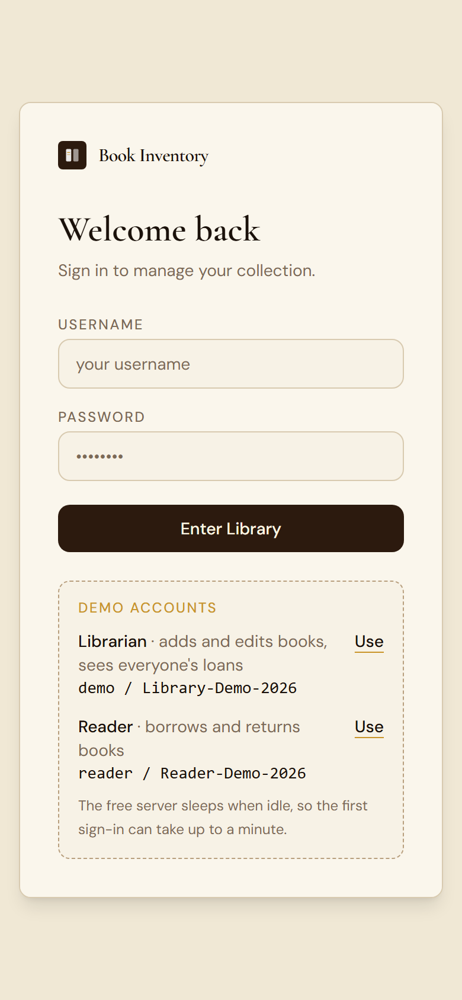
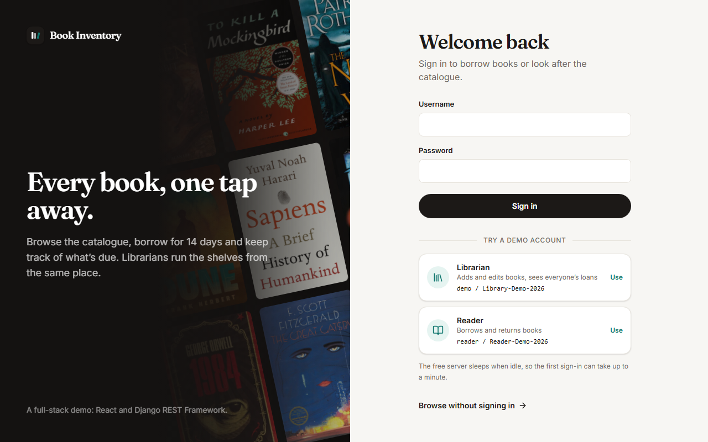
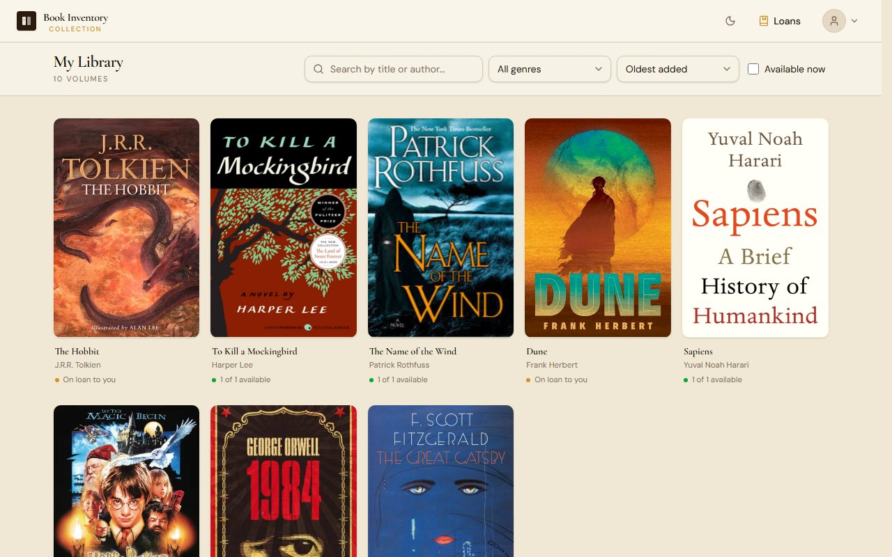
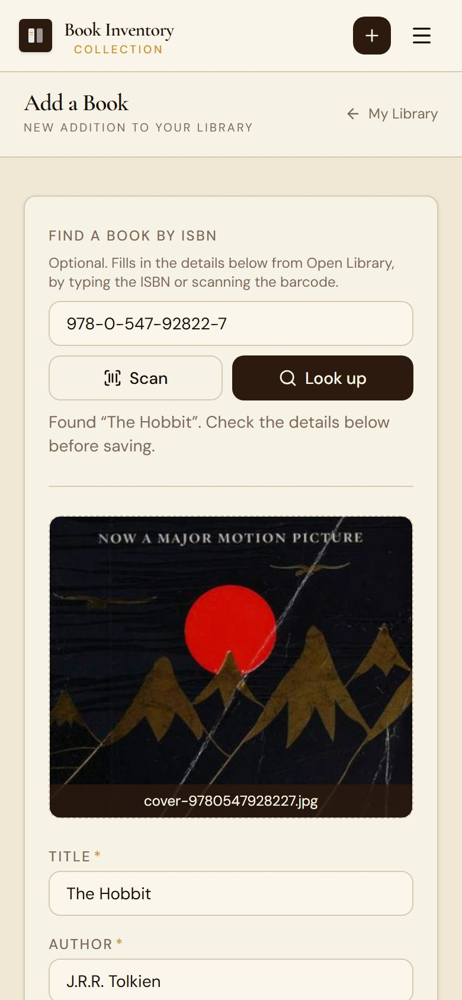
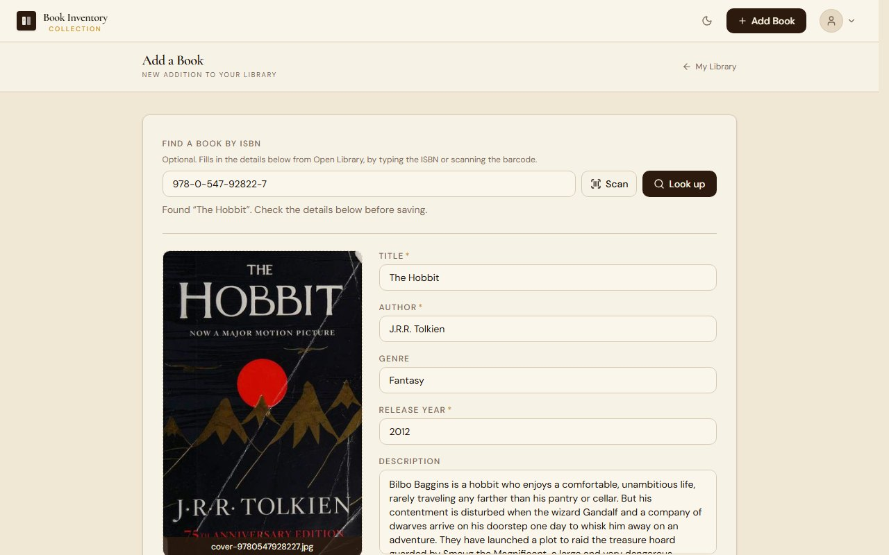
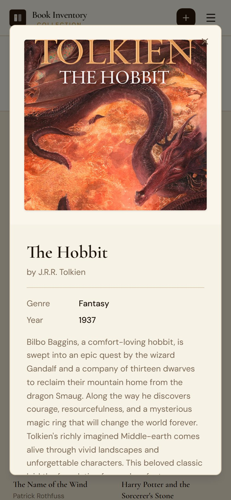
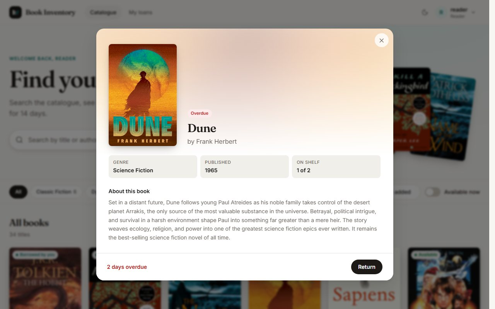

# Book Inventory

[](https://github.com/jamescastro-dev/book-inventory/actions/workflows/ci.yml)

A full-stack web app for managing a personal book collection. Browse and search your library, then add, edit and delete books with cover images behind a JWT login.

**Live demo:** <https://book-inventory-wheat.vercel.app>

| | |
|---|---|
| Username | `demo` |
| Password | `Library-Demo-2026` |

> The demo runs on free hosting tiers. If nobody has used it for a while, the first sign-in can take up to a minute while the server wakes up. The demo data is shared and publicly editable, so it may be reset at any time.

## Screenshots

| | Mobile (390 px) | Desktop |
|---|---|---|
| **Sign in** |  |  |
| **Library** |  |  |
| **Add by ISBN** |  |  |
| **Book detail** |  |  |

## Features

- **Search, filter, sort and page** through the collection: search by title or author, filter by genre, and sort by title, author, year or date added. All of it runs on the server, which returns the books 8 per page, so the list stays fast as the collection grows.
- **Book details** in a modal: cover, author, genre, release year and description.
- **Add, edit and delete** books, including cover image upload and a delete confirmation step.
- **Add a book by ISBN**: type an ISBN-10 or ISBN-13, or **scan the barcode with the phone's camera**, and the form fills in the title, author, year, a suggested genre, the description and the cover from [Open Library](https://openlibrary.org) (no API key). The ISBN's check digit is verified first, answers are cached, and lookups are rate limited. The browser fetches the cover and uploads it like any picked file, so it goes through the same 5 MB check and ends up in your own Cloudinary storage. Scanning uses the browser's built-in barcode reader where there is one (Chrome on Android) and a WebAssembly reader everywhere else (including iPhone Safari), served with the app and only downloaded when you tap Scan.
- **JWT authentication** with a 60-minute access token. Reading books is public; creating, editing and deleting require a valid token and are enforced by the API, not just the UI. Signed-out visitors don't see the Add, Edit or Delete controls, and an expired session sends you back to the sign-in page.
- **Upload and login limits**: cover images are capped at 5 MB (checked in the browser and again on the server), and sign-in attempts are limited to 5 per minute and 30 per hour per IP address.
- **Interactive API docs**: an OpenAPI schema generated from the code, with Swagger UI at `/api/docs/` to try the endpoints (including signed-in ones).
- **Light and dark themes**, remembered between visits.
- **Responsive layout** that works down to phone width.
- **Cloud image storage**: covers are uploaded to Cloudinary, so the app server stays stateless.
- **Resized covers**: the grid loads 400 px thumbnails and the details view 800 px versions, made on demand by Cloudinary and sent as WebP or AVIF where the browser supports it. For the 10 sample books the first page of covers is about 0.3 MB instead of 3.7 MB. The original upload is kept and still returned as `image`.

## Tech stack

| Layer | Technology |
|---|---|
| Frontend | React 19, Vite, React Router, Tailwind CSS 4, Axios, Lucide icons |
| Backend | Django 4.2, Django REST Framework, Simple JWT, WhiteNoise, Gunicorn |
| Database | PostgreSQL (hosted on Neon); SQLite for local development |
| API docs | OpenAPI 3 schema and Swagger UI via drf-spectacular |
| Media | Cloudinary |
| Hosting | Vercel (frontend), Render (backend) |
| Testing and CI | Django test runner, Node's built-in test runner, ESLint, GitHub Actions |

```
Browser ── React SPA (Vercel) ──HTTPS/JSON──> Django REST API (Render) ──> PostgreSQL (Neon)
                                                        └──────────────> Cloudinary (cover images)
```

## API

Interactive documentation (Swagger UI) is at <https://book-inventory-backend-kl82.onrender.com/api/docs/>, where you can try every endpoint. On free hosting the first load can take up to a minute while the server wakes up. Locally it is at <http://localhost:8000/api/docs/>, and the raw OpenAPI schema at `/api/schema/`. The tables below are a summary.

| Method | Path | Auth | Description |
|---|---|---|---|
| `GET` | `/api/books/` | public | One page of books, with optional `search`, `genre`, `ordering`, `page` and `page_size` (see below) |
| `GET` | `/api/books/genres/` | public | Genres in use, each with its number of books |
| `GET` | `/api/books/lookup/?isbn=` | JWT | Book details from Open Library for an ISBN (title, author, year, suggested genre, description, cover link). `400` for an invalid ISBN, `404` if unknown, `502` if Open Library is down, `429` past 20 a minute |
| `POST` | `/api/books/create/` | JWT | Create a book (multipart form, optional `image` up to 5 MB) |
| `PUT` | `/api/books/<id>/` | JWT | Update a book (partial updates allowed) |
| `DELETE` | `/api/books/<id>/` | JWT | Delete a book |
| `POST` | `/api/auth/login/` | public | Exchange `username` and `password` for `access` and `refresh` tokens (rate limited: `429` once the limit is hit) |
| `POST` | `/api/auth/token/refresh/` | public | Get a new access token from a refresh token |
| `GET` | `/api/auth/me/` | JWT | Current user |
| `GET` | `/health/` | public | Liveness check (used by an uptime monitor to keep the free server warm) |

Send the token as `Authorization: Bearer <access>`. There is no public sign-up: accounts are created by the owner (see [Managing users](#managing-users)).

`GET /api/books/` takes these query parameters, all optional:

| Parameter | Meaning |
|---|---|
| `search` | Words to find in the title or author, ignoring case. Every word must match. |
| `genre` | Only books of this genre, ignoring case. |
| `ordering` | `title`, `author`, `release_year` or `created_at`; prefix with `-` to reverse. Titles and authors sort ignoring case, and ties are broken by id so a book never appears on two pages. |
| `page`, `page_size` | Page number (from 1) and page length (default 8, at most 50). A page past the end returns `404`. |

The response is `{"count", "page", "page_size", "total_pages", "results": [...]}`. Each book carries its cover three times: `image` (the original upload), `image_medium` (800 px wide) and `image_thumb` (400 px wide), all `null` when the book has no cover.

## Run it locally

**Prerequisites:** Python 3.12, Node.js 20.19+ or 22.12+, and Git. A free [Cloudinary](https://cloudinary.com) account is only needed to upload new covers.

### 1. Backend

```bash
cd server
python -m venv .venv
source .venv/bin/activate          # Windows PowerShell: .\.venv\Scripts\Activate.ps1
pip install -r requirements.txt
cp .env.example .env               # Windows: copy .env.example .env
```

Edit `server/.env` (every variable is explained inside the file):

| Variable | Needed | Notes |
|---|---|---|
| `DJANGO_SECRET_KEY` | yes | The app will not start without it. Generate one with `python -c "from django.core.management.utils import get_random_secret_key; print(get_random_secret_key())"` |
| `DJANGO_DEBUG` | no | `True` for local development |
| `DATABASE_URL` | no | **Leave blank locally** to use a SQLite file. If you point it at a hosted database, `migrate`, `seed_demo` and the tests act on that database |
| `CLOUDINARY_CLOUD_NAME`, `CLOUDINARY_API_KEY`, `CLOUDINARY_API_SECRET` | yes, all three | Must be non-empty or any request that returns a cover image fails. To only browse locally, use `dn2kyvutt` as the cloud name (it serves the sample covers publicly) and any placeholder for the key and secret. To upload covers, use your own credentials |
| `CORS_ALLOWED_ORIGINS`, `CSRF_TRUSTED_ORIGINS`, `DJANGO_ALLOWED_HOSTS` | no | Defaults work for local development |

Then set up the database and start the server:

```bash
python manage.py migrate
python manage.py seed_demo         # creates the demo user and the 10 sample books
python manage.py runserver         # http://localhost:8000
```

### 2. Frontend

```bash
cd client
npm install
cp .env.example .env               # Windows: copy .env.example .env
npm run dev                        # http://localhost:5173
```

`client/.env` points at `http://localhost:8000` by default. Open <http://localhost:5173> and sign in with the demo account above.

### Tests and lint

```bash
cd server && python manage.py test        # keep DATABASE_URL blank so tests use a throwaway SQLite database
cd client && npm run lint && npm test && npm run build
```

[GitHub Actions](.github/workflows/ci.yml) runs the same checks on every push and pull request, plus `manage.py check` and `makemigrations --check`.

- **Server (over 60 tests):** the book list (pagination, search, genre filter, sorting, stable paging), who may create, edit and delete books, validation and the 5 MB cover limit down to the exact byte, the resized cover URLs, login, token refresh, the per-IP login limit (including a forged `X-Forwarded-For`), the OpenAPI schema (it must stay warning-free and list every endpoint), the demo seed command, and that sign-up stays closed. The tests need no Cloudinary account: uploads are swapped for a stand-in storage.
- **Client:** the helpers that talk to the API: query building, error messages, and the session-expiry wrapper. Two of these tests also read the server's source to fail if the client's 5 MB limit or sort options drift from the API's.

## Managing users

Run these from `server/` with the virtual environment active. They act on whichever database `DATABASE_URL` points at.

```bash
python manage.py createsuperuser           # create an admin (can also use /admin/)
python manage.py changepassword <username> # reset a forgotten password
python manage.py seed_demo                 # create or repair the demo user, restore any missing sample books
python manage.py seed_demo --reset-books   # also revert edited sample books to their original values
```

`seed_demo` is safe to run repeatedly and never deletes anything. It matches sample books by title and author, so a sample book that was *renamed* looks like a missing one and is restored alongside it. Delete the extra copy by hand. The demo user is a normal, non-admin account with the same create, edit and delete rights as any other user.

## Deployment

- **Backend (Render):** [`render.yaml`](render.yaml) defines the web service (root `server/`). The build installs `requirements.txt`, runs `migrate` and `collectstatic`, and the service starts with Gunicorn. Set the environment variables from `server/.env.example` in the Render dashboard, with `DATABASE_URL` pointing at the Neon database and `CORS_ALLOWED_ORIGINS` set to the Vercel URL.
- **Frontend (Vercel):** import the repo with `client/` as the root directory. Set `VITE_API_URL`, `VITE_API_BOOKS_URL` and `VITE_API_AUTH_URL` (see `client/.env.example`) before building, because Vite inlines them at build time. [`client/vercel.json`](client/vercel.json) rewrites every path to `index.html` for client-side routing.
- **Free-tier note:** Render's free web service sleeps when idle. The frontend sends a background request on load to wake it, and `/health/` is available for an uptime monitor.

## Project structure

```
client/                      React single-page app
  src/pages/                 Login, book list, add-book
  src/components/books/      Book card, details, edit modal, form, search
  src/context/               Auth context and provider (JWT in localStorage)
  src/utils/                 API helpers (auth wrapper, query building, upload errors) and their tests
server/                      Django project
  book_inventory/api/        Book model, REST views, filtering, pagination, resized covers, demo_books.json fixture
  book_inventory/accounts/   Login/me endpoints, seed_demo command
  book_inventory/config/     Settings, URLs, WSGI
docs/screenshots/            Images used in this README
.github/workflows/ci.yml     Continuous integration
render.yaml                  Render service definition
```
